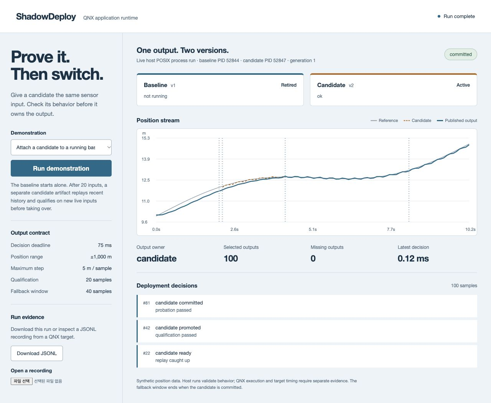

# QNX ShadowDeploy

ShadowDeploy gives a new sensor-processing application the same inputs as the running baseline. A QNX broker checks the candidate's outputs and response times before switching output authority at an input sequence boundary. During probation, the broker keeps the baseline available for fallback. The example uses a synthetic position stream.

## Evaluator overview

- **Host:** The local workbench runs the compiled broker and separate worker processes over POSIX pipes.
- **QNX x86-64 in QEMU:** All 11 functional scenarios reached their expected outcomes using native IPC at a 100 ms period and a 75 ms decision budget. At the default 20 ms period and 10 ms budget, five scenarios stopped early on deadline failures. The default IPC cutoff is 7.5 ms. Hardware timing remains unmeasured. [Verification record](docs/verification.md#native-qnx-execution-2026-11-23)
- **Raspberry Pi 4B (2 GB):** QNX AArch64 application artifacts were cross-built. BSP image provisioning and execution on the physical board are pending. [Pi qualification procedure](docs/qnx-pi4-qualification.md)

[Play the 44-second English demonstration](docs/native-qnx-demo.mp4) or see [trace provenance and release gates](docs/evaluator.md). The video presents selected decisions from archived native QNX guest runs.



## Run the host demo

On Linux or macOS, use CMake 3.20+, a C++17 compiler, and Python 3.9+.

```sh
cmake -S . -B build -DCMAKE_BUILD_TYPE=Debug
cmake --build build --parallel 2
python3 tools/serve.py
```

Open <http://127.0.0.1:8765>. Select **Attach a candidate to a running baseline** and click **Run demonstration**. The broker attaches the candidate after 20 inputs. Watch **Deployment decisions** for replay completion, promotion, and commit. **Output owner** switches to the candidate during probation, and the baseline retires at commit. Inspect **Missing outputs** and save the trace with **Download JSONL**.

<details>
<summary>Operator-controlled staging and cancellation</summary>

```sh
./build/shadow-demo --worker ./build/shadow-worker --control-stdin \
  --samples 1000000 > deployment.jsonl
```

After 16 inputs, enter `stage ./build/candidate.manifest` on stdin. Enter `cancel` during replay, qualification, or probation. After cleanup, enter `stage` with the manifest again.

</details>

[Architecture](docs/architecture.md) · [QNX setup](docs/qnx-setup.md) · [Sensor replay and telemetry](docs/preboard-pipeline.md) · [Demo script](docs/demo.md) · [Roadmap](docs/roadmap.md)

Development was assisted by OpenAI Codex. The project makes no certification claim and is independent of QNX. QNX is a trademark of its respective owner. SDK use is subject to QNX's terms. [MIT license](LICENSE)
