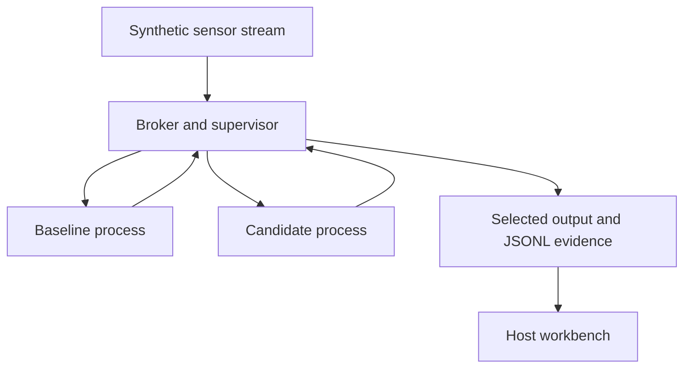

# Architecture and behavior contract

## Runtime boundary

Live mode starts the baseline alone and attaches a candidate later. The fault-scenario mode starts both together. Each has private filter state. A broker owns the input sequence, the deployment state machine, and the only selected output stream. Workers return estimates and have no output consumer connection in this example.

This is logical authority separation among cooperative programs. It is not a security sandbox: the current implementation does not configure filesystem/device/network permissions or resource quotas for untrusted workers.

## Sample and output contracts

All local IPC peers must use the same ABI, architecture, and protocol version. The binary structs are not a network serialization format. Compile-time size checks and runtime header checks reject known layout/version mismatches; heterogeneous targets need explicit serialization in a future protocol.

| Message | Size | Fields |
| --- | --- | --- |
| Header | 8 bytes | Signature, protocol version, message kind |
| Hello | 16 bytes | Header, QNX channel ID or host sentinel, reserved word |
| Sample | 32 bytes | Header, sequence, monotonic acquisition timestamp, position in meters |
| Estimate reply | 48 bytes | Header, echoed sequence/timestamp, position in meters, velocity in meters/second, 8-byte completion footer |

Protocol v2 requires a canonical estimate reply on both transports. The QNX broker allocates fresh reply storage with the footer and an additional 8-byte guard initialized to zero for every exchange. Each canonical footer byte is nonzero, so every contiguous short copy leaves an invalid footer. The host broker reads exactly the envelope size and validates the same footer and header.

`MsgSend` returns the server's `long` status. Status 48 is a protocol convention and the QNX broker also checks the header, footer and guard. QNX copies at most the supplied receive capacity and exposes no reply byte count to the caller. Oversized copies that change the guard fail. Oversized replies that leave the observed guard bytes equal to the initial zeros are indistinguishable from a canonical reply with the same status. The canonical worker supplies exactly 48 bytes. The native exchange retains its single round trip and deadline. [QNX MsgReply](https://www.qnx.com/developers/docs/8.0/com.qnx.doc.neutrino.lib_ref/topic/m/msgreply.html)

The broker supplies sequence and acquisition time. Workers cannot establish freshness by stamping old data with a new completion time. The parent records receipt completion using `CLOCK_MONOTONIC` on the same machine. Transport completion includes dispatch-thread scheduling and IPC, not just algorithm execution.

The default contract is defined in `Contract`:

- Absolute position at most 1,000 m; absolute velocity at most 100 m/s.
- Finite numeric values and no more than a 5 m position change per sample.
- Matching sequence and acquisition timestamp.
- Completion within the decision budget; IPC gets an earlier cutoff at 75% of that budget.
- Consecutive qualifying candidate samples before promotion, followed by a bounded probation window.

Each worker also has a position residual check against the current measured input. The broker compares the absolute measurement-to-estimate difference with 1 m of slack plus a filter lag allowance. For each sample, it adds 2 m/s times the larger of the configured period and the elapsed acquisition interval to the previous lag allowance, then retains 75% of that sum for the slowest supported filter (alpha 0.25). The initial lag allowance is seeded at three times that sample's motion allowance. This gives a 1.12 m residual limit at the default 20 ms cadence. A result becomes invalid on the fifth consecutive excess. An in-limit result clears the streak. Structural, deadline and range checks run first.

The check runs independently for both live workers, including standby and the committed candidate, and on catch-up replay. A replay failure rejects preparation. Live residual state starts fresh for each candidate generation, while baseline state persists. The check uses measured input directly and can detect a frozen estimate on a moving trace or a sustained bias above its allowance. Stationary input can agree with a frozen estimate. Smaller biases, fewer than five consecutive excesses, and input faults shared by measurement and estimate can go undetected. This calibration assumes sensor motion and noise consistent with the demo, and a sustained transient outside that envelope can invalidate healthy results.

These example thresholds are not a general correctness oracle. Each real application must define units, tolerances, freshness and transition constraints. Candidate-baseline difference is observable, but equality is not a pass condition.

## State and authority

| Phase | Selected output | Transition |
| --- | --- | --- |
| `idle` | Baseline | Await a local stage command |
| `warming` | Baseline | Validate the manifest, start the candidate and replay history in the background |
| `shadowing` | Baseline | Reject on the first candidate violation; qualify after N valid samples |
| `probation` | Candidate | Enter at the next sequence boundary; keep baseline warm |
| `committed` | Candidate | Enter after M valid probation samples; retire baseline |
| `rejected` | Baseline | Retire candidate; continue baseline if valid |
| `rolled_back` | Baseline | Use this sample's valid baseline result and retire candidate |
| `failed` | None | Stop output; no automatic restart in this MVP |

When both workers start together, qualification N=20 uses the baseline for samples 1–20 and can promote on sample 21. In live mode, counting starts on the first fresh input after replay has caught up; replayed samples never count toward qualification. The promotion sample is the first probation sample. With M=40, a healthy candidate commits on sample 60.

On candidate failure during probation, rollback requires a valid baseline estimate for the **current** input. The selected stream's continuity check also applies to rollback. If neither output is valid, standby protection is lost during probation, or the switch would violate continuity, output stops. An unqualified candidate never replaces a failed baseline.

Before publishing a candidate estimate at promotion or on any probation sample, including the commit boundary, the broker checks that the candidate's distance from the current baseline plus a one-sample baseline motion allowance fits within the 5 m selected-output step. The allowance assumes that the baseline estimate changes by at most 2 m/s over an interval no longer than the larger of the configured period and the latest observed acquisition interval. At a 20 ms interval the allowance is 0.04 m. When this margin is exhausted the broker rejects promotion or rolls back immediately, using the current baseline estimate if it is valid and continuous. Worker failures and operator cancellation keep their existing precedence. The built-in demo trajectory is compatible with this example motion envelope. Irregular acquisition gaps, external traces that move faster, and invalid standby results can still make fallback unavailable.

Candidate errors after commit stop output because the baseline has been retired. After rejection or rollback, live mode accepts another candidate once cleanup completes. Qualification, probation and candidate continuity state reset for the new generation; baseline and selected-output state do not. Staging after commit is rejected: rotating the committed candidate into a new baseline role is not implemented.

## Process and transport ownership

`WorkerProcess` owns its child PID, IPC resources and one persistent dispatch thread. The input slot allows at most one outstanding sample. Both workers receive a sample before the broker waits for either result. A timed-out or malformed transport is marked unusable, preventing late or partial replies from being reused.

Children are created with `posix_spawn`. Pipe descriptors are close-on-exec. The handshake read has a three-second budget from the point the parent starts reading, after spawn. The sample worker has no descendants. Production process-group isolation remains outside the C++ runtime.

The broker retires a live candidate synchronously after publishing a rejection, rollback or stop decision. It retires the baseline the same way after the commit or stop decision. At exit it destroys any remaining workers and cancels and joins an outstanding stager. A prepared worker still owned by the stager is retired on that background thread before staging reports completion. Retirement signals the dispatch thread and joins it, detaches the native connection, closes pipe descriptors, then sends SIGKILL to the owned child and calls blocking `waitpid`, retrying on EINTR. The dispatch thread refers directly to its implementation, whose members stay alive until the join completes.

For per-sample retirement, the broker has already collected both futures. Its decision latency ends at selection, before synchronous JSONL emission and retirement. Join, teardown and reaping elapsed time can therefore increase the next acquisition interval or skip nominal slots without appearing in that decision's latency. Exit cleanup may continue after the summary and before process exit. The IPC cutoff covers an exchange. Scheduling, join, detach and reap have no measured end-to-end retirement bound.

The run summary records `worker_retirement_samples`, the number of sample boundaries with synchronous worker retirement, and `max_worker_retirement_ns`, the maximum observed time spent destroying those workers on one boundary. The monotonic interval starts after the sample's JSONL write returns and ends after worker destruction returns. If both workers retire on the same boundary, their combined elapsed time contributes one measurement. The maximum is null when no sample retires a worker. The measurement covers per-sample retirement and excludes stager cleanup and shutdown cleanup after the summary.

One design for [issue #4](https://github.com/SungJaeYu/qnx-shadow-deploy/issues/4) is a preallocated retirement slot and an independently scheduled reaper. First revoke authority at a sample boundary, then transfer the owned worker to the slot without waiting for cleanup. Keep its resources charged to the deployment budget until reaping completes and refuse a retry while the slot is occupied. Reserve sufficient capacity for each worker that a decision can retire, including stop when both can retire together. Track time from authority removal to reaper receipt, dispatch exit, detach and reap. A cleanup watchdog would expose overdue work and block new admission while retaining ownership. Validate bounded broker enqueue, reaper scheduling, pending-resource limits and shutdown behavior under contention before changing production cleanup. This design requires review.

| Build | Data path | Timeout |
| --- | --- | --- |
| QNX | Worker `ChannelCreate(0)`, parent `ConnectAttach`, `MsgSend`, `MsgReceive`, `MsgReply` | `TimerTimeout(CLOCK_MONOTONIC, SEND | REPLY | TIMER_ABSTIME, ...)` immediately before `MsgSend` |
| Linux/macOS | Nonblocking pipes and complete fixed-size transfers | `poll` plus a shared absolute monotonic deadline |

QNX uses a side-channel connection to avoid descriptor collisions. The worker intentionally does **not** enable `_NTO_CHF_UNBLOCK`, because that flag would require the server to handle unblock pulses before a timed-out sender can return. Startup still uses a pipe to exchange the channel identifier.

Native IPC has run on an x86-64 QNX guest. See [verification](verification.md) for compiler, guest and timing evidence. The [AArch64 Pi 4B qualification procedure](qnx-pi4-qualification.md) covers separate project artifacts, the board-specific BSP and provisioned runtime. The generated manifest must identify the target OS, architecture and protocol of the same build as the candidate binary. A project cross-build provides executable and manifest artifacts. Board bootability and timing need evidence from the provisioned system.

## Timing and state preparation

The synthetic source follows a wall-clock schedule and skips missed releases instead of bursting delayed samples. Acquisition, IPC receipt, and decision latency are separate concepts. If selection itself misses the decision budget, the broker stops output. JSON rendering, pipe consumption and browser display happen afterward and are **not** included in that decision latency. In the default mode, a slow stdout consumer can delay future releases.

### Dedicated authoritative output

Set `--output-fd FD` to pass the broker a dedicated pipe or FIFO write end above
descriptor 2. The launcher must provide a single write-only descriptor with no
aliases in the broker and keep the reader open and draining during the run.
The broker rejects a sink shared with stdin, stdout or stderr, sets
`O_NONBLOCK`, and marks the authority descriptor close-on-exec before any
worker starts. `O_NONBLOCK` applies to the open file description, so the
launcher should close its copy of the writer and avoid sharing it with other
processes.

Each selected result gets one authoritative JSONL record with
`type: "authoritative_output"`, `schema: 1`, `producer_run_id`, `sequence`,
`source`, `position_m`, and `deadline_ns`. The deadline uses
`CLOCK_MONOTONIC` on the broker host. The broker checks this deadline before
an atomic write of at most the pipe's `_PC_PIPE_BUF`. It does not retry. A
full pipe, a disconnected reader, a write error or an expired write budget
stops the run with exit status 4. The broker also stops if it observes a
successful write return after the deadline. The resulting record is already
in the pipe and still carries its expiry. Consumers must reject expired
records and implement their own timeout and safe state if output ceases.

In this mode, run stdout through a separate writable pipe for best-effort
telemetry or use `--no-telemetry` when stdout goes to a terminal or file.
Keep stderr separate when stdout telemetry is enabled. The broker sets
`O_NONBLOCK` on diagnostic and telemetry pipe writers. Give the broker
exclusive use of the stdout write end so other writers cannot interleave
bytes of a partial row. The broker retains at most one unfinished row, tries
to finish it before emitting the next row, and drops new rows when the pipe
cannot accept them. Once authority has closed, the broker allows up to 20 ms
for telemetry draining. If an unfinished row cannot be completed within
that window or the reader disconnects, the broker stops writing telemetry.
Consumers should process newline-terminated rows and discard any incomplete
trailing line at EOF. A summary that reaches stdout reports
`telemetry_records_dropped` up to that row.
Stderr also reports the final drop count when nonzero and reports delivery
errors with the last selected and last delivered sequence. Stderr pipe
reports are best-effort under backpressure. Exit status 4 remains the
delivery failure signal when diagnostics cannot be read.

Opt-in sample telemetry adds `output_delivered` and `output_delivery_error`.
The summary adds `delivered_outputs`, the last selected and delivered
sequences (zero before the first such result), and the delivery error.
A delivered output means the kernel accepted the complete record into the
pipe. `external_delivery` remains `"unmeasured"`. Both writes still run on the
broker thread and share scheduling and CPU resources with the rest of the
process. Pipe buffering provides no receiver acknowledgement, hardware
actuation evidence, or real-time scheduling guarantee.

### Late attachment and bounded replay

`CandidateStager` owns a background thread for manifest IO, process startup, replay exchanges and preparation cleanup. The broker retains the newest 64 input samples. The candidate requests a history window of 1–64 samples; insufficient history is rejected. The generated example manifest requests 16.

While startup/replay is running, new inputs are appended to a bounded 64-entry backlog. No input is silently dropped. Overflow, an input gap, invalid replay output, startup failure, or the five-second preparation budget rejects the candidate. Startup's own handshake limit is three seconds. The preparation budget is checked between bounded exchanges, so it is not an exact wall-clock termination guarantee. Cancellation requests cleanup asynchronously; another stage is refused until the previous staging worker finishes.

Replayed samples keep their original sequence and acquisition timestamps so the filter evolves with the original time intervals. Each replay exchange gets a new transport deadline based on its dispatch time. Protocol, echoed sequence/time, numeric values, range and continuity are still checked. Historical results are never published and never counted as fresh qualification evidence.

At an input boundary, ownership transfers only if the backlog is empty, no replay exchange is in flight, and the last replayed sequence equals the immediately preceding live sequence. The first live result is also checked against the final replay result. This prepares the example filter approximately from a bounded history; it does not reproduce arbitrary application state or prove convergence. Applications with different state semantics need an explicit replay/snapshot contract.

### Local manifest and controls

The manifest is a UTF-8-compatible ASCII `key=value` file, at most 4 KiB, with exactly these fields. Blank lines and `#` comment lines are allowed; duplicate, missing and unknown keys are rejected.

| Key | Required value or meaning |
| --- | --- |
| `format` / `protocol` | `1` / `2` |
| `artifact` | 1–64 letters, digits, hyphens, underscores or periods |
| `executable` | Local executable; relative to the manifest directory |
| `architecture` | `x86_64` or `aarch64`, matching the runtime |
| `os` | `linux`, `darwin` or `qnx`, matching the runtime |
| `contract` | `position-m-velocity-mps-v1`; limits remain broker-owned |
| `replay_samples` | Required historical inputs, 1–64 |
| `mode` / `fault_after` | Example adapter mode and fault sequence, 0–1,000,000 |

The worker entrypoint receives `MODE FAULT_AFTER` and must implement the local Hello/Sample/Estimate protocol. This is an example adapter contract, not an arbitrary application launcher. The manifest is checked before spawn, and the child handshake checks the protocol again. Declared architecture and artifact IDs are not a binary digest, signature or authenticated provenance.

`--control-stdin` accepts one bounded command per input cycle: `stage PATH` or `cancel`. `--candidate-manifest PATH --stage-at N` schedules staging after N completed inputs. Stage commands received while a deployment or its cleanup is active are refused. Cancellation during probation still requires a valid, continuous current baseline result. EOF closes only the command input; it does not stop baseline processing.

JSONL schema 2 adds `deployment` records for commands, generation IDs, replay counts, last replayed sequence and candidate PID. Sample records retain baseline/candidate PIDs and the deployment generation. Schema 1 fault recordings remain readable in the workbench.

During live qualification, the stdout path waits for both bounded exchanges. In dedicated output mode the broker checks candidate readiness as soon as the baseline returns. A pending candidate leaves the baseline in authority for this sample. The broker validates the current baseline, attempts its pipe write, then drains the original candidate exchange before the next submission. The omitted sample earns zero promotion credit and retains previously earned credit. Even with sufficient credit, promotion requires a validated candidate on the switch sample. A failed candidate exchange is rejected. Probation continues to require current fallback checks. [Telemetry and deadline semantics](demo.md)

The post-write drain, synchronous retirement and shared CPU and memory can still delay the next acquisition. A consistently slower candidate can stay in shadowing indefinitely. Use the omission counter, skipped nominal slots and write timestamps to distinguish these outcomes.

### Owner decisions for deadline isolation

The owner approved dedicated output delivery with fail-closed delivery errors and baseline-first publication during shadowing. The following design decision remains open for [issue #4](https://github.com/SungJaeYu/qnx-shadow-deploy/issues/4).

- **Admission and retirement.** The owner must identify the target and supported load, the CPU and memory budgets, and what happens when either budget is unavailable or exceeded. Charge preparation and pending cleanup to the budget. Moving retirement off the broker also requires approval of the ownership transfer and shutdown behavior described above.

The baseline-only QNX guest missed the first input deadline under load with phase tracing enabled and disabled. No candidate exchange or per-sample retirement preceded that miss. First verify baseline delivery on the target at the agreed period, budget and load. Then repeat under the same conditions with candidate preparation, qualification, probation and retirement. Compare skipped releases, deadline misses and accepted output records, and check peak resource use and child cleanup against the agreed limits.

## Technical references

- [QNX MsgSend](https://qnx.com/developers/docs/8.0/com.qnx.doc.neutrino.lib_ref/topic/m/msgsend.html)
- [QNX MsgReceive](https://qnx.com/developers/docs/8.0/com.qnx.doc.neutrino.lib_ref/topic/m/msgreceive.html)
- [QNX message metadata](https://qnx.com/developers/docs/8.0/com.qnx.doc.neutrino.lib_ref/topic/m/_msg_info.html)
- [QNX TimerTimeout, including unblock behavior](https://qnx.com/developers/docs/8.0/com.qnx.doc.neutrino.lib_ref/topic/t/timertimeout.html)
- [QNX process creation](https://qnx.com/developers/docs/8.0/com.qnx.doc.neutrino.sys_arch/topic/proc_posix_spawn.html)
