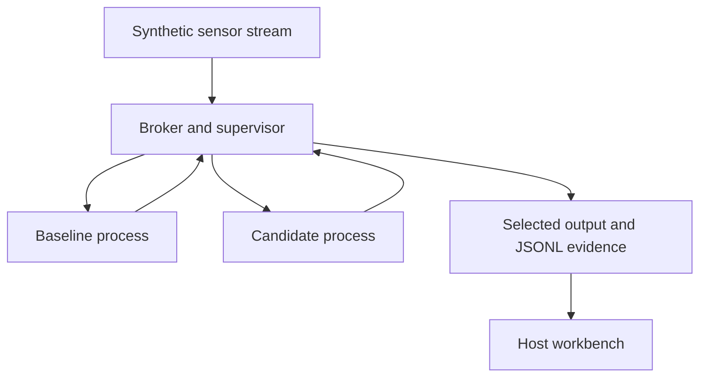

# Architecture and behavior contract

## Runtime boundary

Live mode starts the baseline alone and attaches a candidate later. The fault-scenario mode starts both together. Each has private filter state. A broker owns the input sequence, the deployment state machine, and the only selected output stream. Workers return estimates and have no output consumer connection in this example.

This is logical authority separation among cooperative programs. It is not a security sandbox: the current implementation does not configure filesystem/device/network permissions or resource quotas for untrusted workers.

## Sample and output contracts

All local IPC peers must use the same ABI, architecture, and protocol version. The binary structs are not a network serialization format. Compile-time size checks and runtime header checks reject known layout/version mismatches; heterogeneous targets need explicit serialization in a future protocol.

| Message | Size | Fields |
| --- | --- | --- |
| Header | 8 bytes | Signature, protocol version, message kind |
| Hello | 16 bytes | Header, QNX channel ID or host sentinel, reserved word |
| Sample | 32 bytes | Header, sequence, monotonic acquisition timestamp, position in meters |
| Estimate | 40 bytes | Header, echoed sequence/timestamp, position in meters, velocity in meters/second |

The broker supplies sequence and acquisition time. Workers cannot establish freshness by stamping old data with a new completion time. The parent records receipt completion using `CLOCK_MONOTONIC` on the same machine. Transport completion includes dispatch-thread scheduling and IPC, not just algorithm execution.

The default contract is defined in `Contract`:

- Absolute position at most 1,000 m; absolute velocity at most 100 m/s.
- Finite numeric values and no more than a 5 m position change per sample.
- Matching sequence and acquisition timestamp.
- Completion within the decision budget; IPC gets an earlier cutoff at 75% of that budget.
- Consecutive qualifying candidate samples before promotion, followed by a bounded probation window.

These example thresholds are not a general correctness oracle. Each real application must define units, tolerances, freshness and transition constraints. Candidate-baseline difference is observable, but equality is not a pass condition.

## State and authority

| Phase | Selected output | Transition |
| --- | --- | --- |
| `idle` | Baseline | Await a local stage command |
| `warming` | Baseline | Validate the manifest, start the candidate and replay history in the background |
| `shadowing` | Baseline | Reject on the first candidate violation; qualify after N valid samples |
| `probation` | Candidate | Enter at the next sequence boundary; keep baseline warm |
| `committed` | Candidate | Enter after M valid probation samples; retire baseline |
| `rejected` | Baseline | Retire candidate; continue baseline if valid |
| `rolled_back` | Baseline | Use this sample's valid baseline result and retire candidate |
| `failed` | None | Stop output; no automatic restart in this MVP |

When both workers start together, qualification N=20 uses the baseline for samples 1–20 and can promote on sample 21. In live mode, counting starts on the first fresh input after replay has caught up; replayed samples never count toward qualification. The promotion sample is the first probation sample. With M=40, a healthy candidate commits on sample 60.

On candidate failure during probation, rollback requires a valid baseline estimate for the **current** input. The selected stream's continuity check also applies to rollback. If neither output is valid, standby protection is lost during probation, or the switch would violate continuity, output stops. An unqualified candidate never replaces a failed baseline.

Candidate errors after commit stop output because the baseline has been retired. After rejection or rollback, live mode accepts another candidate once cleanup completes. Qualification, probation and candidate continuity state reset for the new generation; baseline and selected-output state do not. Staging after commit is rejected: rotating the committed candidate into a new baseline role is not implemented.

## Process and transport ownership

`WorkerProcess` owns its child PID, IPC resources and one persistent dispatch thread. The input slot allows at most one outstanding sample. Both workers receive a sample before the broker waits for either result. A timed-out or malformed transport is marked unusable, preventing late or partial replies from being reused.

Children are created with `posix_spawn`. Pipe descriptors are close-on-exec. A startup handshake has a three-second bound. Retiring a child closes its descriptors, terminates that owned child, and reaps it. The sample worker must not spawn descendants; production process-group isolation is not implemented in the C++ runtime.

| Build | Data path | Timeout |
| --- | --- | --- |
| QNX | Worker `ChannelCreate(0)`, parent `ConnectAttach`, `MsgSend`, `MsgReceive`, `MsgReply` | `TimerTimeout(CLOCK_MONOTONIC, SEND | REPLY | TIMER_ABSTIME, ...)` immediately before `MsgSend` |
| Linux/macOS | Nonblocking pipes and complete fixed-size transfers | `poll` plus a shared absolute monotonic deadline |

QNX uses a side-channel connection to avoid descriptor collisions. The worker intentionally does **not** enable `_NTO_CHF_UNBLOCK`, because that flag would require the server to handle unblock pulses before a timed-out sender can return. Startup still uses a pipe to exchange the channel identifier.

Native QNX code has been checked against official API documentation but has not been compiled against proprietary headers or exercised on a QNX kernel. Review/build is not runtime evidence.

## Timing and state preparation

The synthetic source follows a wall-clock schedule and skips missed releases instead of bursting delayed samples. Acquisition, IPC receipt, and decision latency are separate concepts. If selection itself misses the decision budget, the broker stops output. JSON rendering, pipe consumption and browser display happen afterward and are **not** included in that decision latency. A slow stdout consumer can delay future releases; this telemetry path is not suitable for a production hard real-time output channel.

### Late attachment and bounded replay

`CandidateStager` owns a background thread for manifest IO, process startup, replay exchanges and preparation cleanup. The broker retains the newest 64 input samples. The candidate requests a history window of 1–64 samples; insufficient history is rejected. The generated example manifest requests 16.

While startup/replay is running, new inputs are appended to a bounded 64-entry backlog. No input is silently dropped. Overflow, an input gap, invalid replay output, startup failure, or the five-second preparation budget rejects the candidate. Startup's own handshake limit is three seconds. The preparation budget is checked between bounded exchanges, so it is not an exact wall-clock termination guarantee. Cancellation requests cleanup asynchronously; another stage is refused until the previous staging worker finishes.

Replayed samples keep their original sequence and acquisition timestamps so the filter evolves with the original time intervals. Each replay exchange gets a new transport deadline based on its dispatch time. Protocol, echoed sequence/time, numeric values, range and continuity are still checked. Historical results are never published and never counted as fresh qualification evidence.

At an input boundary, ownership transfers only if the backlog is empty, no replay exchange is in flight, and the last replayed sequence equals the immediately preceding live sequence. The first live result is also checked against the final replay result. This prepares the example filter approximately from a bounded history; it does not reproduce arbitrary application state or prove convergence. Applications with different state semantics need an explicit replay/snapshot contract.

### Local manifest and controls

The manifest is a UTF-8-compatible ASCII `key=value` file, at most 4 KiB, with exactly these fields. Blank lines and `#` comment lines are allowed; duplicate, missing and unknown keys are rejected.

| Key | Required value or meaning |
| --- | --- |
| `format` / `protocol` | `1` / `1` |
| `artifact` | 1–64 letters, digits, hyphens, underscores or periods |
| `executable` | Local executable; relative to the manifest directory |
| `architecture` | `x86_64` or `aarch64`, matching the runtime |
| `os` | `linux`, `darwin` or `qnx`, matching the runtime |
| `contract` | `position-m-velocity-mps-v1`; limits remain broker-owned |
| `replay_samples` | Required historical inputs, 1–64 |
| `mode` / `fault_after` | Example adapter mode and fault sequence, 0–1,000,000 |

The worker entrypoint receives `MODE FAULT_AFTER` and must implement the local Hello/Sample/Estimate protocol. This is an example adapter contract, not an arbitrary application launcher. The manifest is checked before spawn, and the child handshake checks the protocol again. Declared architecture and artifact IDs are not a binary digest, signature or authenticated provenance.

`--control-stdin` accepts one bounded command per input cycle: `stage PATH` or `cancel`. `--candidate-manifest PATH --stage-at N` schedules staging after N completed inputs. Stage commands received while a deployment or its cleanup is active are refused. Cancellation during probation still requires a valid, continuous current baseline result. EOF closes only the command input; it does not stop baseline processing.

JSONL schema 2 adds `deployment` records for commands, generation IDs, replay counts, last replayed sequence and candidate PID. Sample records retain baseline/candidate PIDs and the deployment generation. Schema 1 fault recordings remain readable in the workbench.

Once live qualification starts, the current broker still waits for both bounded exchanges before selecting output. A slow candidate can therefore delay the decision up to that cutoff. Background preparation does not resolve this remaining active-path coupling. CPU scheduling and memory contention remain shared. Two processes do not automatically provide deadline isolation. Target priorities, admission control, load testing, resource policy and an independent telemetry path are explicit remaining gates.

## Technical references

- [QNX MsgSend](https://qnx.com/developers/docs/8.0/com.qnx.doc.neutrino.lib_ref/topic/m/msgsend.html)
- [QNX MsgReceive](https://qnx.com/developers/docs/8.0/com.qnx.doc.neutrino.lib_ref/topic/m/msgreceive.html)
- [QNX message metadata](https://qnx.com/developers/docs/8.0/com.qnx.doc.neutrino.lib_ref/topic/m/_msg_info.html)
- [QNX TimerTimeout, including unblock behavior](https://qnx.com/developers/docs/8.0/com.qnx.doc.neutrino.lib_ref/topic/t/timertimeout.html)
- [QNX process creation](https://qnx.com/developers/docs/8.0/com.qnx.doc.neutrino.sys_arch/topic/proc_posix_spawn.html)
